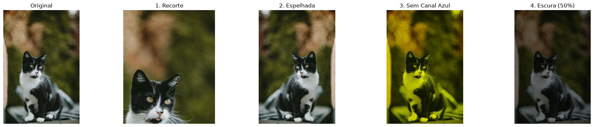

# 🖼️ NumPy Image Playground

Um mini editor e processador de imagens experimental desenvolvido em Python, utilizando **NumPy** para manipulação direta de matrizes multidimensionais e **Matplotlib** / **Pillow** para I/O e visualização de dados.

## 🚀 Sobre o Projeto
O objetivo deste projeto foi explorar o processamento de imagens digitais sob a ótica da computação vetorial e álgebra linear. Em vez de utilizar bibliotecas de edição prontas ou "caixas pretas", cada transformação é aplicada diretamente sobre a matriz tridimensional da imagem ($Altura \times Largura \times Canais$), demonstrando eficiência de performance e compreensão profunda de estruturas de dados.

## 🛠️ Tecnologias Utilizadas
* **Python 3.x**
* **NumPy** (Manipulação de matrizes, fatiamento vetorial e operações aritméticas seguras)
* **Pillow (PIL)** (Carregamento e manipulação de arquivos de imagem)
* **Matplotlib** (Renderização de subplots e exportação de resultados consolidados)

## ⚙️ Funcionalidades Implementadas
1. **Recorte Proporcional (*Slicing*):** Isola uma região de interesse utilizando porcentagens dinâmicas das dimensões da imagem.
2. **Espelhamento Horizontal:** Inversão de eixos usando o passo negativo do NumPy (`::-1`).
3. **Manipulação de Canais de Cor:** Isolamento e remoção seletiva de canais RGB (ex: remoção do canal azul).
4. **Ajuste de Brilho Vetorizado:** Operação matemática em lote com restrição de limites (`np.clip`) para evitar *overflow* de pixels e conversão segura para `uint8`.

## 📊 Exemplo de Saída
O script processa a imagem original e gera um relatório visual consolidado lado a lado:

## 📦 Como Executar o Projeto Localmente

Siga os passos abaixo para clonar o repositório e executar o script no seu ambiente local usando um ambiente virtual (`venv`):

### 1. Clone o repositório
\`\`\`bash
git clone https://github.com/natykmlima/mini-editor-de-fotos-numpy.git
cd mini-editor-de-fotos-numpy
\`\`\`

### 2. Crie e ative um ambiente virtual
* **No Linux / macOS / WSL:**
  \`\`\`bash
  python3 -m venv .venv
  source .venv/bin/activate
  \`\`\`
* **No Windows (PowerShell):**
  \`\`\`powershell
  python -m venv .venv
  .venv\\Scripts\\Activate.ps1
  \`\`\`

### 3. Instale as dependências
\`\`\`bash
pip install -r requirements.txt
\`\`\`

### 4. Execute o script
\`\`\`bash
python editornumpy.py
\`\`\`
